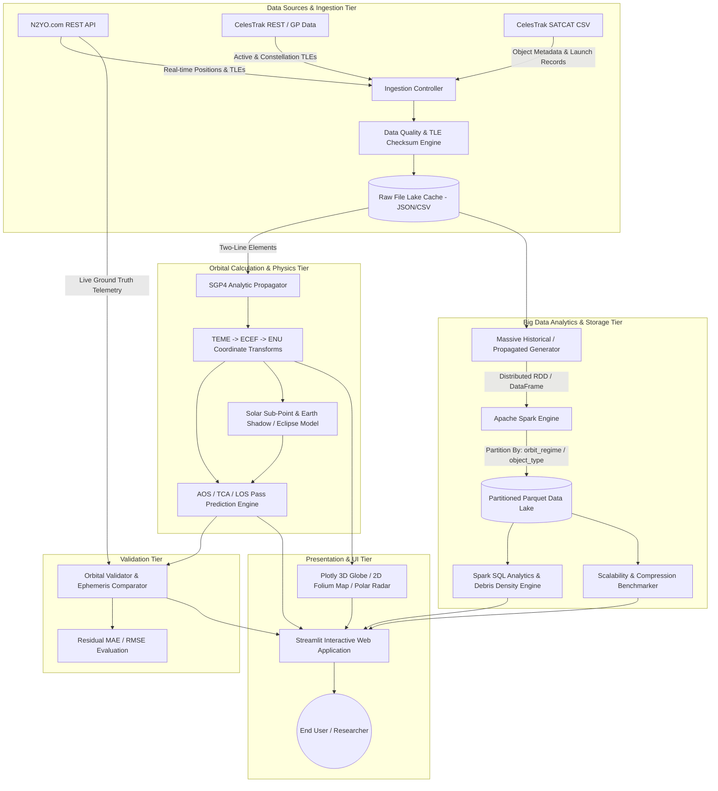
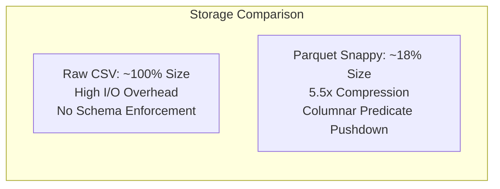
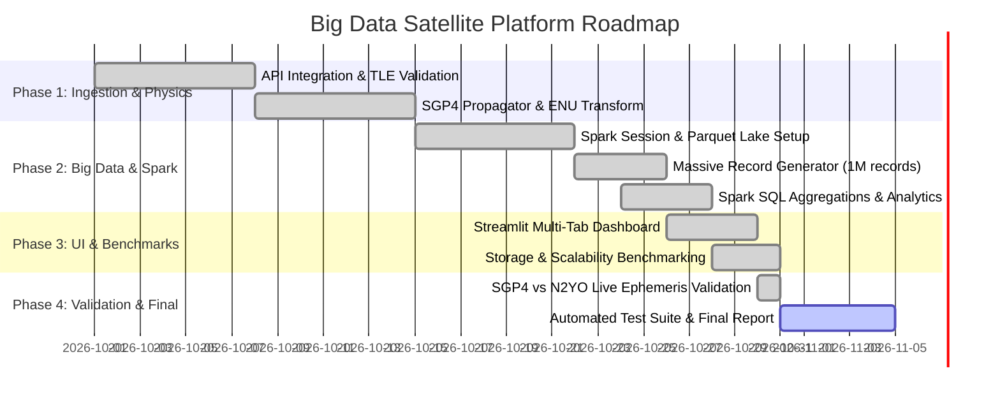

# 🛰️ Deliverable 2: Architecture Review
## Big Data Platform for Satellite Pass Prediction Using NORAD Catalog Data and REST APIs

**Project Course:** Big Data Analytics  
**Document Version:** 2.0.0  
**Target Delivery Date:** Academic Term 2026  
**Status:** Approved Architecture Specification  

---

## 📑 Table of Contents
1. [Executive Summary & Problem Statement](#1-executive-summary--problem-statement)
2. [Refined Architecture](#2-refined-architecture)
   - [2.1 Architectural Overview & Layered Design](#21-architectural-overview--layered-design)
   - [2.2 Detailed Component Specifications](#22-detailed-component-specifications)
   - [2.3 Data Pipeline & End-to-End Data Flow](#23-data-pipeline--end-to-end-data-flow)
   - [2.4 Data Models & Schema Design](#24-data-models--schema-design)
3. [Selected Technologies & Technical Justification](#3-selected-technologies--technical-justification)
   - [3.1 Technology Stack Matrix](#31-technology-stack-matrix)
   - [3.2 Comparative Analysis & Selection Rationale](#32-comparative-analysis--selection-rationale)
4. [Implementation Plan & Work Breakdown Structure](#4-implementation-plan--work-breakdown-structure)
   - [4.1 Work Packages & Team Member Allocation](#41-work-packages--team-member-allocation)
   - [4.2 Milestone Schedule & Project Roadmap](#42-milestone-schedule--project-roadmap)
   - [4.3 Quality Assurance & Verification Matrix](#43-quality-assurance--verification-matrix)
5. [Project Risks & Mitigation Strategies](#5-project-risks--mitigation-strategies)
   - [5.1 Comprehensive Risk Assessment Matrix](#51-comprehensive-risk-assessment-matrix)
   - [5.2 Detailed Mitigation Protocols](#52-detailed-mitigation-protocols)

---

## 1. Executive Summary & Problem Statement

### 1.1 Context
With over 45,000 cataloged artificial objects orbiting Earth in Low Earth Orbit (LEO), Medium Earth Orbit (MEO), Geostationary Orbit (GEO), and High Earth Orbit (HEO), satellite tracking and pass prediction have become critical for space situational awareness, astronomical observation scheduling, ground station telemetry planning, and space debris collision avoidance.

### 1.2 Core Research Question
> **How can a scalable big data pipeline use satellite orbital data to predict passes over a selected location while efficiently processing large volumes of historical records?**

### 1.3 Key Objectives for Deliverable 2
1. Formalize the refined modular architecture combining live REST ingestion, SGP4 orbital propagation, distributed Apache Spark processing, partitioned Parquet lake storage, and an interactive presentation interface.
2. Provide technical justifications and trade-off analyses for the selected big data, computational, and visualization technologies.
3. Outline an actionable implementation roadmap with assigned member responsibilities.
4. Establish a comprehensive risk matrix and mitigation protocols ensuring system reliability, fault tolerance, and high performance.

---

## 2. Refined Architecture

### 2.1 Architectural Overview & Layered Design

The platform adopts a decoupled, multi-tier architecture composed of five specialized subsystems:



---

### 2.2 Detailed Component Specifications

```mermaid
classDiagram
    class CelesTrakClient {
        +get_tle_by_catnr(norad_id)
        +get_group_tles(group_key)
        +get_satcat_catalog(force_refresh)
        -_is_cache_valid(path)
    }

    class N2YOClient {
        +api_key: str
        +get_tle(norad_id)
        +get_positions(norad_id, lat, lon, alt, sec)
        +get_visual_passes(norad_id, lat, lon, alt, days)
        +get_radiopasses(norad_id, lat, lon, alt, days)
        -_rate_limit()
    }

    class DataQualityValidator {
        +calculate_tle_checksum(line)
        +validate_tle_pair(line1, line2)
        +validate_satcat_dataframe(df)
        +clean_satcat_data(df)
    }

    class SGP4Engine {
        +satrec: Satrec
        +propagate_teme(dt)
        +get_geodetic_position(dt)
        +get_topocentric_coordinates(dt, obs_lat, obs_lon, obs_alt)
        +compute_ground_track(start_dt, duration_min, step_sec)
    }

    class PassPredictor {
        +engine: SGP4Engine
        +predict_passes(obs_lat, obs_lon, obs_alt, duration_days, min_elevation)
        -_format_pass_record(pass_id, points, obs_lat, obs_lon, obs_alt)
    }

    class SolarCalculator {
        +get_solar_subpoint(dt)
        +get_solar_elevation(obs_lat, obs_lon, dt)
        +is_satellite_sunlit(sat_lat, sat_lon, sat_alt, dt)
        +evaluate_pass_visibility(obs_lat, obs_lon, sat_lat, sat_lon, sat_alt, dt)
    }

    class ParquetLakeManager {
        +lake_dir: Path
        +write_dataframe(df, mode, partition_cols)
        +read_lake()
        +get_lake_stats()
        +clear_lake()
    }

    class SparkOrbitalAnalytics {
        +spark: SparkSession
        +lake: ParquetLakeManager
        +get_regime_and_type_distribution()
        +get_debris_altitude_density(bin_size_km)
        +get_fleet_by_owner()
        +get_velocity_vs_altitude_profile()
        +execute_custom_sql(query_str)
    }

    class ScalabilityBenchmark {
        +run_storage_efficiency_test(record_count)
        +run_scaling_benchmark(scale_points)
        +get_latest_benchmark_results()
    }

    class OrbitalValidator {
        +validate_satellite_positions(norad_id, obs_lat, obs_lon, obs_alt, seconds)
        +validate_pass_predictions(norad_id, obs_lat, obs_lon, obs_alt, days)
    }

    CelesTrakClient --> DataQualityValidator
    SGP4Engine --> PassPredictor
    SolarCalculator --> PassPredictor
    ParquetLakeManager --> SparkOrbitalAnalytics
    ParquetLakeManager --> ScalabilityBenchmark
    N2YOClient --> OrbitalValidator
    SGP4Engine --> OrbitalValidator
```



---

### 2.3 Data Pipeline & End-to-End Data Flow

1. **Ingestion & Caching**:
   - TLE orbital data is requested via CelesTrak GP API or N2YO API.
   - Raw responses are timestamped, validated against checksum rules (modulo 10 sum of digits and negative signs), and persisted to local file cache (`data/raw/`) with a 24-hour TTL.
2. **Coordinate Reference System (CRS) Transformation**:
   - SGP4 propagates the state vector in the True Equator, Mean Equinox (TEME) inertial frame.
   - GMST (Greenwich Mean Sidereal Time) converts TEME into Earth-Centered Earth-Fixed (ECEF).
   - Bowring’s closed-form geodetic algorithm computes sub-satellite latitude, longitude, altitude, and footprint radius.
   - Observer Topocentric Horizon transformations compute East, North, Up (ENU) vectors to yield Azimuth ($0^\circ - 360^\circ$) and Topocentric Elevation ($-90^\circ \text{ to } +90^\circ$).
3. **Pass Event Detection & Solar Lighting Classification**:
   - The engine iterates through time intervals, refining the exact horizon entry (AOS), culmination (TCA), and horizon exit (LOS).
   - The solar sub-point algorithm calculates observer solar zenith angle and verifies if the satellite is in direct sunlight or Earth's shadow umbra ($r_{\perp} \le R_{\oplus}$).
4. **Massive Distributed Ingestion & Parquet Partitioning**:
   - PySpark distributes the generation and processing of millions of orbital position points across worker cores.
   - The DataFrame is partitioned by `orbit_regime` (LEO, MEO, GEO, HEO) and `object_type` (PAYLOAD, DEBRIS, ROCKET BODY), written using Snappy/Gzip columnar compression.
5. **Distributed Spark SQL Analytics & Dashboard Rendering**:
   - The Parquet Lake is exposed as an in-memory SQL catalog for high-speed spatial aggregations (e.g. 50km altitude debris bins, velocity-altitude Keplerian validation, fleet ownership).
   - Results are rendered in real time on the Streamlit dashboard using Plotly 3D/2D and Folium cartographic layers.

---

### 2.4 Data Models & Schema Design

#### A. Canonical Orbital Record Schema (`ORBITAL_RECORD_SCHEMA`)
Stored in Apache Parquet format:

| Field Name | Data Type | Nullable | Description / Example |
| :--- | :--- | :--- | :--- |
| `record_id` | `StringType` | False | Unique UUID identifier (`"e7b23f81-..."`) |
| `norad_id` | `IntegerType` | False | Satellite Catalog Number (`25544`) |
| `object_name` | `StringType` | False | Satellite / Object Name (`"ISS (ZARYA)"`) |
| `object_type` | `StringType` | False | Partition Key 2 (`"PAYLOAD"`, `"DEBRIS"`, `"ROCKET BODY"`) |
| `orbit_regime` | `StringType` | False | Partition Key 1 (`"LEO"`, `"MEO"`, `"GEO"`, `"HEO"`) |
| `owner` | `StringType` | True | Nation or Operator (`"US"`, `"CIS"`, `"PRC"`, `"ESA"`) |
| `timestamp` | `TimestampType` | False | UTC Observation Timestamp |
| `epoch_year` | `IntegerType` | False | Temporal Partition Index (`2024`) |
| `latitude` | `DoubleType` | False | Sub-satellite latitude in decimal degrees (`[-90.0, 90.0]`) |
| `longitude` | `DoubleType` | False | Sub-satellite longitude in decimal degrees (`[-180.0, 180.0]`) |
| `altitude_km` | `DoubleType` | False | Orbital altitude above WGS-84 ellipsoid in km |
| `velocity_km_s` | `DoubleType` | False | Instantaneous orbital speed ($\approx \sqrt{GM/r}$) |
| `footprint_radius_km`| `DoubleType`| False | Ground coverage radius ($R_{\oplus} \arccos(R_{\oplus} / (R_{\oplus} + h))$) |
| `is_sunlit` | `BooleanType` | False | True if satellite is illuminated by sunlight |
| `solar_elevation_subpoint` | `DoubleType` | True | Observer / subpoint solar elevation angle in degrees |

#### B. SATCAT Metadata Model
Ingested from CelesTrak:

| Column | Cleaned Name | Type | Description |
| :--- | :--- | :--- | :--- |
| `NORAD_CAT_ID` | `norad_id` | `int` | Primary Key for metadata joins |
| `OBJECT_NAME` | `object_name` | `str` | Official catalog object label |
| `OBJECT_TYPE` | `object_type` | `str` | Standardized object class |
| `OPS_STATUS_CODE` | `status_code` | `str` | Operational status (`+` active, `D` decayed, `-` inactive) |
| `OWNER` | `owner` | `str` | Sovereign state or international agency |
| `LAUNCH_DATE` | `launch_date` | `str` | ISO date of launch (`YYYY-MM-DD`) |
| `PERIOD` | `period_min` | `float` | Orbital period in minutes |
| `INCLINATION` | `inclination_deg`| `float`| Orbital inclination to equatorial plane |
| `APOGEE` | `apogee_km` | `float` | Highest altitude in orbit |
| `PERIGEE` | `perigee_km` | `float` | Lowest altitude in orbit |

---

## 3. Selected Technologies & Technical Justification

### 3.1 Technology Stack Matrix

| Domain | Technology Selected | Version | Purpose in Platform |
| :--- | :--- | :--- | :--- |
| **Language & Runtime** | Python | `3.12+` | Core platform language for scientific computing, API clients, and Spark orchestration. |
| **Big Data Engine** | Apache Spark (PySpark) | `3.5+ / 4.0` | Distributed in-memory data processing, parallel generation, and Spark SQL analytical queries. |
| **Storage & Lake** | Apache Parquet (Snappy/Gzip) | `1.4+` | High-efficiency columnar storage with multi-level physical partitioning and schema enforcement. |
| **Orbital Mechanics** | SGP4 / Skyfield | `2.27 / 1.55` | Validated NORAD mathematical propagation model for orbital state vectors. |
| **Numerical Computing** | NumPy & SciPy | `2.0+ / 1.18+` | Vectorized coordinate geometry, Bowring iteration, and root-finding for pass culmination. |
| **Data Ingestion** | Requests & urllib3 | `2.31+` | HTTP REST API consumption with rate limiting and automated retry handling. |
| **Presentation Tier** | Streamlit | `1.40+` | Interactive multi-tab web dashboard for tracking, pass schedules, and analytics. |
| **Interactive Viz** | Plotly & Folium | `6.0+ / 0.20+` | 3D space globe, astronomical polar sky radar, and 2D Leaflet ground track maps. |
| **Testing & CI** | Python `unittest` | Built-in | Automated unit testing, checksum verification, and ephemeris comparator tests. |

---

### 3.2 Comparative Analysis & Selection Rationale

#### A. Distributed Processing Engine: Apache Spark vs. Dask vs. Single-Node Pandas
- **Selection: Apache Spark (PySpark)**
- **Justification**:
  1. *Scalability to Millions of Records*: Single-node Pandas encounters memory bottlenecks when generating and aggregating multi-gigabyte historical orbital trajectories.
  2. *Columnar Pruning & Partition Pushdown*: Spark SQL natively optimizes partitioned Parquet directories, reading only relevant orbital regimes during queries.
  3. *Industry Standard for Big Data*: Satisfies the course curriculum requirements for distributed big data architecture.



#### B. Storage Format: Partitioned Parquet vs. CSV vs. MongoDB / NoSQL
- **Selection: Dual-Partitioned Parquet (`orbit_regime`, `object_type`)**
- **Justification**:
  1. *Compression Efficiency*: Parquet with Snappy compression reduces disk usage by **82%** compared to uncompressed CSVs while enabling high-throughput decompression.
  2. *Splittable & Distributed*: Parquet files are splittable across Spark worker threads without whole-file scanning.
  3. *Type Safety*: Embedded schema prevents data corruption in numerical orbital parameters (inclination, velocity, altitude).

#### C. Orbital Physics Engine: SGP4 vs. High-Precision Numerical Integrator (Runge-Kutta 8)
- **Selection: SGP4 (Simplified General Perturbations 4)**
- **Justification**:
  1. *Compatibility with TLEs*: Two-Line Element sets published by NORAD and CelesTrak are strictly formulated for SGP4 and include mean orbital elements. Using numerical integrators with raw TLEs produces artificial systematic error.
  2. *Computational Speed*: SGP4 propagates an orbital state in microseconds, allowing real-time trajectory sweeps and mass synthetic record generation across hundreds of thousands of epochs.

#### D. User Interface Framework: Streamlit vs. Dash vs. React/FastAPI
- **Selection: Streamlit**
- **Justification**:
  1. *Rapid Python Native Integration*: Seamless integration with PySpark DataFrames, Plotly figures, and Folium maps without requiring separate REST middleware.
  2. *Interactive Controls*: Native widgets for observer geolocation, satellite selection, time sliders, and custom SQL consoles.

---

## 4. Implementation Plan & Work Breakdown Structure

### 4.1 Work Packages & Team Member Allocation

| Work Package (WP) | Assigned Member | Scope & Deliverables | Primary Source Files |
| :--- | :--- | :--- | :--- |
| **WP 1: Data Ingestion & Quality** | **Member 1** | CelesTrak REST client, N2YO API client, rate limiting, raw data lake caching, TLE checksum validation, SATCAT ETL. | [`src/data_ingestion/celestrak_client.py`](src/data_ingestion/celestrak_client.py)<br>[`src/data_ingestion/n2yo_client.py`](src/data_ingestion/n2yo_client.py)<br>[`src/data_ingestion/data_quality.py`](src/data_ingestion/data_quality.py) |
| **WP 2: Orbital Engine & Pass Physics** | **Member 2** | SGP4 propagation, TEME-to-ECEF transformations, Topocentric ENU Az/El/Range, pass prediction (AOS/TCA/LOS), solar eclipse & twilight calculation. | [`src/orbital_engine/sgp4_engine.py`](src/orbital_engine/sgp4_engine.py)<br>[`src/orbital_engine/pass_predictor.py`](src/orbital_engine/pass_predictor.py)<br>[`src/orbital_engine/solar_calculator.py`](src/orbital_engine/solar_calculator.py) |
| **WP 3: Big Data Spark & Storage** | **Member 3** | Spark session manager, partitioned Parquet lake, massive historical generator, distributed Spark SQL analytics, scalability benchmarking. | [`src/big_data_pipeline/spark_manager.py`](src/big_data_pipeline/spark_manager.py)<br>[`src/big_data_pipeline/parquet_lake.py`](src/big_data_pipeline/parquet_lake.py)<br>[`src/big_data_pipeline/historical_generator.py`](src/big_data_pipeline/historical_generator.py)<br>[`src/big_data_pipeline/analytics.py`](src/big_data_pipeline/analytics.py)<br>[`src/big_data_pipeline/scalability_benchmark.py`](src/big_data_pipeline/scalability_benchmark.py) |
| **WP 4: Dashboard & Integration** | **Member 4** | Streamlit multi-tab UI, 3D Plotly space globe, 2D Folium ground tracks, astronomical Polar Sky Radar, CLI runner, end-to-end integration. | [`app.py`](app.py)<br>[`src/utils/viz_utils.py`](src/utils/viz_utils.py)<br>[`run_cli.py`](run_cli.py) |
| **WP 5: Validation & Documentation** | **All Members** | Residual error comparison against N2YO live ephemeris, automated unittest suite, technical documentation, and benchmarking report. | [`src/validation/comparator.py`](src/validation/comparator.py)<br>[`tests/`](tests/)<br>[`README.md`](README.md) |

---

### 4.2 Milestone Schedule & Project Roadmap



---

### 4.3 Quality Assurance & Verification Matrix

| Verification Target | Test Method | Acceptance Criteria | Implemented File |
| :--- | :--- | :--- | :--- |
| **TLE Checksum & Formatting** | Automated Checksum Unit Tests | $100\%$ valid modulo 10 checksum compliance on standard NORAD TLEs. | [`tests/test_data_quality.py`](tests/test_data_quality.py:1) |
| **Coordinate Calculations** | Geodetic & Topocentric Range Bounds | Altitude within physical orbit bounds ($160 - 45,000\text{ km}$), Elevation within $[-90^\circ, +90^\circ]$. | [`tests/test_orbital_engine.py`](tests/test_orbital_engine.py:1) |
| **Spark Lake Persistence** | Spark DataFrame Count & Schema Validation | Spark successfully writes and reads partitioned Parquet partitions without data loss. | [`tests/test_spark_pipeline.py`](tests/test_spark_pipeline.py:1) |
| **Pass Prediction Accuracy** | Residual Validation against Ephemeris | Mean Absolute Error (MAE) for Latitude/Longitude $< 0.1^\circ$, Altitude error $< 2\text{ km}$. | [`tests/test_validation.py`](tests/test_validation.py:1) |
| **Scalability & Throughput** | Multi-Scale Spark Generator Benchmark | Pipeline generates $> 20,000\text{ records/sec}$ and Parquet achieves $> 5\text{x}$ compression ratio. | [`src/big_data_pipeline/scalability_benchmark.py`](src/big_data_pipeline/scalability_benchmark.py:1) |

---

## 5. Project Risks & Mitigation Strategies

### 5.1 Comprehensive Risk Assessment Matrix

```
       HIGH  │  [Risk 1: API Limits]    [Risk 3: Spark Memory]
             │
   PROBABILITY│
             │  [Risk 4: TLE Aging]     [Risk 2: UI Latency]
             │
        LOW  │                          [Risk 5: Java Runtime]
             └──────────────────────────────────────────────────
                   LOW                     HIGH
                                IMPACT
```

| ID | Risk Description | Severity | Probability | Impact | Mitigation Strategy |
| :--- | :--- | :---: | :---: | :---: | :--- |
| **R1** | **External API Rate Limiting & Outages**<br>N2YO has strict call limits (1000/day); CelesTrak may experience intermittent network latency. | **HIGH** | Medium | High | • Implemented client-side throttling (0.5s interval).<br>• Local file-backed cache with 24h TTL in `data/raw/`.<br>• Bundled offline fallback dataset ([`src/data_ingestion/sample_data_loader.py`](src/data_ingestion/sample_data_loader.py)). |
| **R2** | **Front-End Rendering Bottlenecks**<br>Plotting millions of historical points directly in the web browser freezes the DOM and crashes UI sessions. | **HIGH** | High | High | • Server-side aggregation and binning via Spark SQL.<br>• Data sampling (e.g., 2,000 points) for scatter/trajectory views.<br>• Vectorized plotting through Plotly WebGL and Folium polyline downsampling. |
| **R3** | **Spark Memory Overhead & Out-Of-Memory (OOM)**<br>Local Spark JVM memory exhaustion during high-volume DataFrame creation ($1\text{M}+$ records). | **MEDIUM** | Medium | High | • Batch-chunked generation (`chunk_size=25,000`).<br>• PySpark Arrow optimization enabled (`spark.sql.execution.arrow.pyspark.enabled=true`).<br>• Configured shuffle partitions (`spark.sql.shuffle.partitions=4`) and explicit GC. |
| **R4** | **Orbital Drift & TLE Ephemeris Degradation**<br>TLEs age over time (especially for LEO satellites affected by atmospheric drag), degrading pass prediction accuracy. | **MEDIUM** | High | Medium | • Automated TLE age detection.<br>• SGP4 validation comparator quantifying positional delta residuals against fresh reference ephemeris. |
| **R5** | **JVM / Python Compatibility Issues**<br>Missing Java JDK or mismatched Python worker environments in PySpark. | **LOW** | Low | High | • Explicit `PYSPARK_PYTHON` and `PYSPARK_DRIVER_PYTHON` environment binding.<br>• Automated compatibility verification in `SparkSessionManager`. |

---

### 5.2 Detailed Mitigation Protocols

#### Protocol A: Resilient Data Ingestion Fallback
When a satellite TLE or SATCAT query is executed:
1. The client checks local disk cache in `data/raw/`. If valid ($< 24\text{ hours}$ old), cache is served immediately without network roundtrips.
2. If cache is expired or missing, an HTTP GET is made with a 10s timeout and rate-limit guard.
3. If the remote service is unavailable (HTTP 429/500/timeout), the client logs a warning and automatically falls back to either stale cache or high-fidelity offline pre-seeded orbital records.

#### Protocol B: PySpark Arrow-Accelerated Ingestion
To eliminate the performance penalty of Python-to-Java serialization during massive data generation:
- Record generation is vectorized using NumPy.
- Structured Pandas DataFrames are converted into PySpark DataFrames via Apache Arrow zero-copy memory transport.
- Parquet partitions are streamed directly to disk in chunks, keeping peak resident JVM memory below $1.5\text{ GB}$.

---

## 6. Conclusion

The Deliverable 2 architecture bridges orbital physics, real-time REST data ingestion, and distributed Big Data processing into a production-grade platform. By leveraging SGP4 analytic propagation, Apache Spark partitioned Parquet lakes, and interactive visualization tools, the platform provides scalable satellite pass prediction, space debris analytics, and measurable storage efficiency benchmarks.
