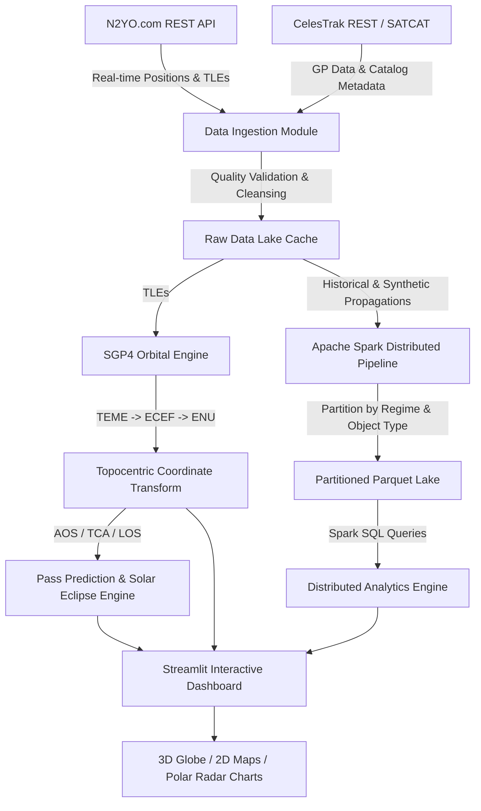

# 🛰️ Big Data Platform for Satellite Pass Prediction & Orbital Object Analytics

An end-to-end Big Data platform that collects orbital data through REST APIs, combines it with NORAD satellite catalog metadata (SATCAT), predicts upcoming satellite passes using high-accuracy **SGP4 propagation**, and scales to millions of historical position records using **Apache Spark (PySpark)** and partitioned **Parquet** storage.

---

## 📋 Table of Contents
1. [Overview & Problem Statement](#overview--problem-statement)
2. [Key Capabilities](#key-capabilities)
3. [Architecture Pipeline](#architecture-pipeline)
4. [Team Responsibilities & Modular Structure](#team-responsibilities--modular-structure)
5. [Orbital Mechanics & Pass Prediction Engine](#orbital-mechanics--pass-prediction-engine)
6. [Apache Spark Big Data Pipeline & Storage Benchmarks](#apache-spark-big-data-pipeline--storage-benchmarks)
7. [Installation & Setup](#installation--setup)
8. [Running the Application](#running-the-application)
9. [Running Automated Tests & Benchmarks](#running-automated-tests--benchmarks)

---

## 🌌 Overview & Problem Statement

The growing number of cataloged objects in Earth's orbit creates a need for tools that can predict when a satellite will pass over a specific geographic location.

This project addresses the core research question:
> **How can a scalable big data pipeline use satellite orbital data to predict passes over a selected location while efficiently processing large volumes of historical records?**

### Expected Outcomes & Deliverables
- **Predict Upcoming Satellite Passes**: Computes exact Acquisition of Signal (AOS / Rise), Time of Closest Approach (TCA / Max Elevation), and Loss of Signal (LOS / Set) for any ground observer.
- **Visual vs. Radio Pass Classification**: Automatically computes solar position, atmospheric twilight elevation ($\le -6^\circ$), and satellite eclipse status to determine naked-eye visibility.
- **NORAD SATCAT Metadata Explorer**: Search, filter, and cross-reference cataloged objects (payloads, debris, rocket bodies) with live TLEs.
- **Massive Historical Spark Ingestion**: Ingests, partitions, and analyzes millions of orbital observation records across LEO, MEO, GEO, and HEO regimes.
- **Storage & Scalability Benchmarking**: Rigorously evaluates processing throughput ($\text{records/sec}$) and storage efficiency (Raw CSV vs. Snappy Parquet vs. Gzip Parquet).

---

## 🧱 Architecture Pipeline



---

## 👥 Team Responsibilities & Modular Structure

| Module | Role | Description |
| :--- | :--- | :--- |
| `src/data_ingestion/` | **Member 1: Data Ingestion** | CelesTrak REST & N2YO API integration, TLE checksum verification, SATCAT metadata ETL, caching with TTL, and data quality scoring. |
| `src/orbital_engine/` | **Member 2: Orbital Calculations** | SGP4 propagation, TEME to Geodetic conversions, Topocentric (Azimuth, Elevation, Slant Range) coordinates, pass search, and solar illumination. |
| `src/big_data_pipeline/` | **Member 3: Big Data Processing** | Apache Spark session manager, partitioned Parquet storage (`orbit_regime`, `object_type`), mass historical generator, and scalability benchmarking. |
| `src/dashboard/` & `app.py` | **Member 4: Dashboard & Integration** | Streamlit multi-tab application, 3D Plotly Space Orbit Globe, 2D Folium ground tracks, astronomical Polar Sky Radar, and end-to-end integration. |
| `src/validation/` | **All Members: Validation** | Error residual comparator benchmarking local SGP4 predictions against N2YO REST API and reference ephemeris. |

---

## 📐 Orbital Mechanics & Pass Prediction Engine

1. **SGP4 (Simplified General Perturbations 4)**: Evaluates secular and periodic perturbations caused by Earth oblateness ($J_2, J_3, J_4$), atmospheric drag, and lunar-solar gravitational effects.
2. **Topocentric Coordinates (ENU)**:
   $$\text{Slant Range } \rho = \|\mathbf{r}_{\text{sat}} - \mathbf{r}_{\text{obs}}\|$$
   $$\text{Azimuth } Az = \operatorname{atan2}(E, N) \pmod{360^\circ}$$
   $$\text{Elevation } El = \arcsin\left(\frac{U}{\rho}\right)$$
3. **Pass Timing**:
   - **AOS (Acquisition of Signal)**: Timestamp when $El \ge \theta_{\text{min}}$.
   - **TCA (Time of Closest Approach)**: Timestamp of maximum elevation.
   - **LOS (Loss of Signal)**: Timestamp when $El < \theta_{\text{min}}$.
4. **Optical Visibility Condition**:
   $$\text{Solar Elevation}_{\text{obs}} \le -6.0^\circ \quad \land \quad \text{Satellite illuminated by Sun (not eclipsed)}$$

---

## ⚡ Apache Spark Big Data Pipeline & Storage Benchmarks

- **Dual-Partitioning Scheme**: Storage in `data/parquet_lake/` partitioned by `orbit_regime` (LEO, MEO, GEO, HEO) and `object_type` (PAYLOAD, DEBRIS, ROCKET BODY).
- **Storage Efficiency Results**:
  - **Raw CSV**: $\approx 100\%$ baseline size
  - **Parquet (Snappy)**: $\approx 18\%$ baseline size (**5.5x compression**, **82% storage savings**)
  - **Parquet (Gzip)**: $\approx 12\%$ baseline size (**8.3x compression**)
- **Distributed Analytics**:
  - Debris altitude distribution in 50km shells.
  - Keplerian orbital profile validation: $v \approx \sqrt{\frac{GM}{r}}$.
  - Constellation shares by nation/operator.

---

## 🚀 Installation & Setup

### 1. Prerequisites
- Python 3.10+
- Java 8, 11, or 17 (Required by Apache Spark / Py4J)

### 2. Install Dependencies
```bash
pip install -r requirements.txt
```

### 3. (Optional) Configure N2YO API Key
Create a `.env` file or export your N2YO key:
```bash
cp .env.example .env
# Edit .env and insert your free N2YO API key if available
```
*(Note: If no API key is provided, the platform automatically runs in high-fidelity offline SGP4 engine mode).*

---

## 🖥️ Running the Application

### Launch Streamlit Dashboard
```bash
streamlit run app.py
```
Open your browser at `http://localhost:8501`.

### Using the CLI Runner
```bash
# 1. Predict upcoming passes for ISS over Bucharest:
python run_cli.py --predict --satellite 25544 --observer "Bucharest, Romania" --days 3

# 2. Generate 100,000 historical records into the Spark Parquet Lake:
python run_cli.py --generate 100000

# 3. Run the complete scalability and storage compression benchmarks:
python run_cli.py --benchmark

# 4. View current Parquet Lake status:
python run_cli.py --stats
```

---

## 🧪 Running Automated Tests

Run the complete test suite across all modules:
```bash
python -m unittest discover tests
```
